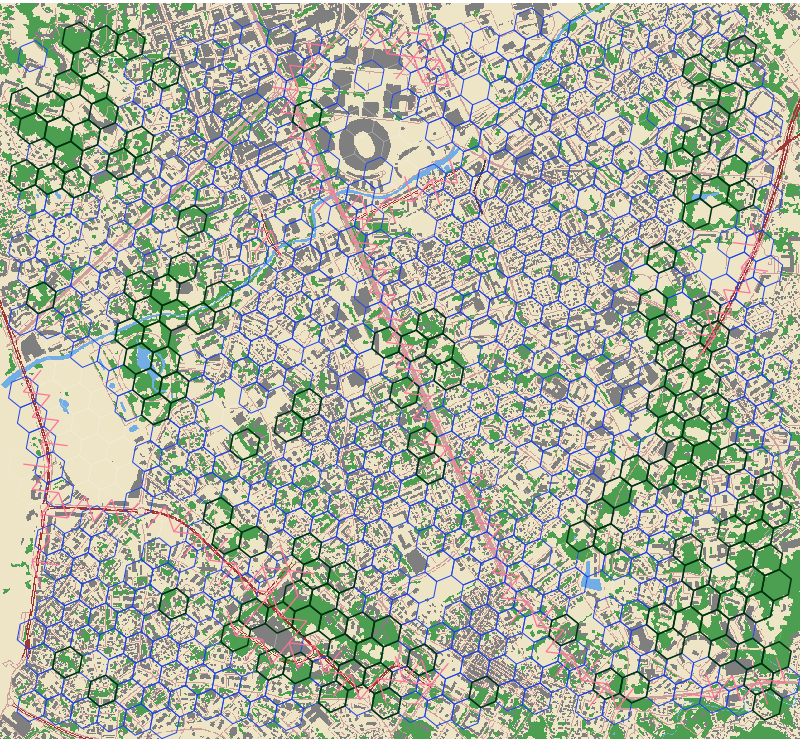
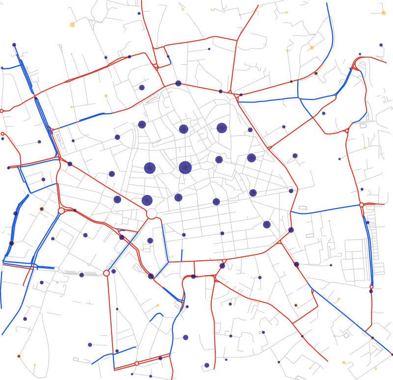
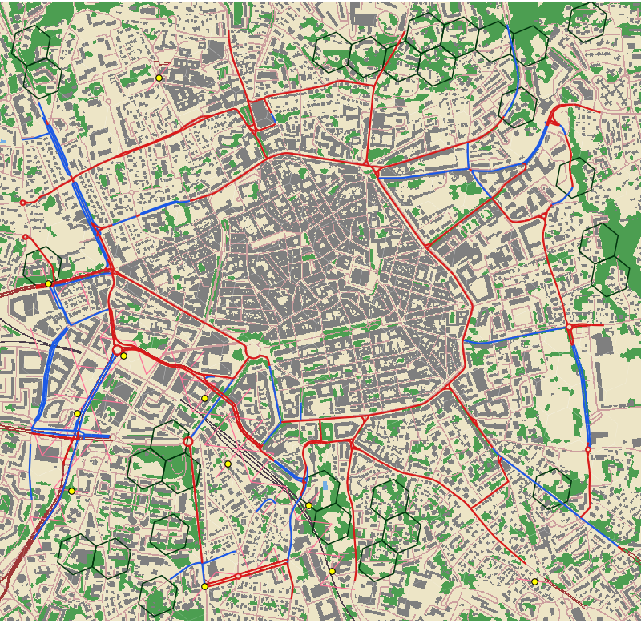

# GECOT benchmark

A fixed set of instances and budgets for comparing the algorithms of
`gecot optimize`, and the effect of their parameters.

| | |
|---|---|
| `instances/` | the instances, one directory each |
| `suites/full.csv`, `suites/short.csv` | the runs (instance, budget) of the two suites |
| `run.py` | runs one algorithm, with fixed parameters, over a suite |
| `compare.py` | compares result files |
| `best_known.csv` | best known score and bound of the runs made so far |
| `generate/` | the scripts that built the instances |

## Running it

```
python3 benchmark/run.py flow_mip
python3 benchmark/run.py --suite short flow_mip
python3 benchmark/run.py --suite short --label tight flow_mip --big-m tight
python3 benchmark/compare.py benchmark/results/flow_mip.csv benchmark/results/tight.csv
```

`run.py` needs Python 3 only. It uses `build/gecot` unless `--gecot` says
otherwise, runs one run at a time (the solvers use every core), and passes
what follows the algorithm to it unchanged.

| suite | runs | time limit of a run | longest possible |
|---|---|---|---|
| `full` | 86 | 900 s | 23.5 h |
| `short` | 42 | 120 s | 1.9 h |

The short suite is a part of the full one. `--time-limit` changes the limit.

The limit is given to the algorithms that have a `--time-limit` parameter. A
run still going 5 % + 10 s past the limit receives Ctrl-C, which makes GECOT
return its best solution so far, and is killed 30 s later. So no run lasts more than
1.05 × limit + 40 s, which gives the last column.

Each run appends a line to `results/<label>.csv` as soon as it ends; the label
is the algorithm and its parameters unless `--label` names it. The solution
and the log of each run are kept in `results/<label>/`, with `meta.json` (the
command, the version of GECOT, the machine). Running the same command again
resumes after the last run written; `--force` starts over.

Columns of a result file:

| column | |
|---|---|
| `status` | of GECOT's report: `optimal`, `time limit reached`, `interrupted`, `completed` (a heuristic); `failed` if there is no result |
| `wall_time` | seconds, the whole process |
| `time` | seconds, as GECOT reports it |
| `initial_score`, `score`, `bound`, `cost` | score without any option, score and cost of the solution, upper bound proven by the algorithm (empty if none) |
| `nodes` | of the branch and bound, when reported |
| `exit` | exit code, or `ctrl-c`, `killed` |

`compare.py` prints two Markdown tables: one line per run, then a summary per
result file. Gains are over the initial score:

- a time: the algorithm proved its solution optimal in that time;
- *reached*: its gain as a share of the best known gain;
- *guaranteed*: its gain as a share of the largest gain its own bound allows.

The best known score of a run is the best of the files compared and of
`best_known.csv`; `compare.py --save-best` updates that file. A score above
another algorithm's bound is reported as inconsistent.

## Instances

| instance | kind of options | cases | vertices | arcs | options | total cost | budgets (**short suite**) |
|---|---|---|---|---|---|---|---|
| `dks-30` | vertex | 1 | 31 | 436 | 30 | 30 | 6, **9**, **12**, **15** |
| `dks-50` | vertex | 1 | 51 | 1174 | 50 | 50 | **10**, **15**, 20, 25 |
| `cover-40` | arc | 1 | 361 | 680 | 40 | 40 | **8**, **12**, **16**, 20 |
| `cover-80` | arc | 1 | 721 | 2000 | 80 | 80 | **8**, **16**, **24**, 32, 40 |
| `natural-crossing` | crossing | 1 | 825 | 2064 | 28 | 78,000 | 3000, **6000**, 12000, **21000**, **30000**, 39000 |
| `periurban-mixed` | greening, planting, crossing | 1 | 1551 | 3948 | 129 | 123,529 | 1000, **2500**, **6000**, **12000**, 25000, 63000 |
| `rural-planting` | planting | 1 | 2571 | 6616 | 122 | 1,712 | 20, **90**, 170, **260**, **510**, 850 |
| `urban-greening` | greening | 1 | 2457 | 6320 | 131 | 46,592 | 500, **1000**, 2500, **7500**, **15000**, 23000 |
| `urban-greening-large` | greening | 1 | 4728 | 12284 | 228 | 79,220 | 800, **1600**, **4000**, **8000**, 16000, 40000 |
| `bike-town` | bike lane | 1 | 1624 | 4230 | 164 | 17,528 | **250**, **500**, 1000, 2000, 4000 |
| `bike-suburb` | bike lane | 1 | 4609 | 11502 | 263 | 46,166 | **500**, 1000, **2000**, 5000, 10000 |
| `faircover-40` | arc | 4 | 404 | 720 | 40 | 40 | 8, **12**, **16**, 20 |
| `faircover-80` | arc | 8 | 808 | 2080 | 80 | 80 | **8**, **16**, 24, 32, 40 |
| `species-natural` | crossing, rope bridge | 3 | 2475 | 6192 | 56 | 80,800 | 3000, **6000**, **12000**, 21000, 30000 |
| `species-periurban` | greening, planting, crossing, rope bridge | 2 | 3102 | 7896 | 161 | 126,729 | 1000, **2500**, **6000**, 12000, 25000 |
| `bike-squirrel-town` | planted bike lane, rope bridge | 2 | 2554 | 6568 | 175 | 12,457 | 100, **200**, **300**, 500, 1000 |
| `bike-squirrel-suburb` | planted bike lane, rope bridge | 2 | 5359 | 13372 | 293 | 32,721 | **200**, **500**, 1000, 2000, 5000 |

The first two families are small and hard: reductions from NP-hard problems,
with at most 80 options. The landscapes have more options, of unequal costs
and effects, on real land cover. The bike networks have arc options only, on
real street networks. The last six instances have several cases that share
their options.

### `dks-n`: densest k-subgraph

Given a graph G and k, find k vertices that induce the most edges. The problem
is NP-hard and has no known constant-factor approximation.

- One vertex per vertex of G, of quality 0, and one option of cost 1 that gives
  it a source and a target quality of 1: **vertex improvements only**.
- Two opposite arcs of probability p per edge of G.
- An isolated vertex of quality 1, so that the initial score is 1 and not 0.

With the options S bought, the score is

```
1 + |S| + 2 p e(S) + r(S),      0 ≤ r(S) ≤ |S| (|S| − 1) p²
```

where e(S) counts the edges induced by S and r(S) comes from the pairs of S at
distance 2 or more. With p = 1 / (kmax (kmax − 1)), r(S) ≤ p for every budget
up to kmax, less than the 2p of one more edge. So the optimal solutions of a
budget k ≤ kmax are exactly the densest k-subgraphs, and
e(S) = ⌊(score − 1 − k) / 2p⌋.

G is a random graph where each edge is present with probability 1/2, written
to `graph.csv`. `dks-30` has n = 30 and kmax = 15, `dks-50` n = 50 and
kmax = 25.

### `cover-m`: maximum coverage

Given m subsets of a ground set and k, find k subsets whose union is the
largest. The problem is NP-hard, and NP-hard to approximate within a factor
better than 1 − 1/e.

- One vertex per element, of source quality 1.
- One vertex per subset, of quality 0, with an arc of probability 1 from each
  of its elements.
- A vertex `hub` of source and target quality 1, with an arc of probability 0
  from each subset. One option of cost 1 per subset raises this arc to
  probability 1: **arc improvements only**, one arc per option.

With the options S bought, the score is 1 + the number of elements covered by
the subsets of S.

Each element is in the same number of subsets, drawn at random, written to
`sets.csv`. `cover-40` has 40 subsets, 320 elements and 2 subsets per element:
the elements are the edges of a multigraph on the subsets, and the problem is
maximum k-vertex-cover. `cover-80` has 80 subsets, 640 elements and 3 subsets
per element.

Both reductions were checked against brute force on 16 options, for every
budget up to 8, with `flow_mip`, with and without its preprocessing, and `multicut_benders`.

### Landscapes

The five landscapes are rectangles of the Bouches-du-Rhône, built from the
[BD TOPO](https://geoservices.ign.fr/bdtopo) of IGN (edition of September
2025, Licence Ouverte 2.0) by `generate/landscape.py`. They share one model;
`generate/landscapes.json` gives the rectangle, the grid resolution and the
options of each.

| instance | place | area | resolution | cells | habitat cells | arcs across a barrier | options |
|---|---|---|---|---|---|---|---|
| `urban-greening` | Marseille, 8th and 9th arrondissements | 12 km² | 10 | 819 | 136 | 0 major, 346 secondary | 131 greening |
| `urban-greening-large` | Marseille, 8th to 10th arrondissements | 24 km² | 10 | 1576 | 400 | 48 major, 602 secondary | 228 greening |
| `rural-planting` | Eyragues: farmland, hedgerows and woods | 13 km² | 10 | 857 | 271 | 0 major, 134 secondary | 122 planting |
| `periurban-mixed` | south of Aix-en-Provence: Les Milles and Luynes | 54 km² | 9 | 517 | 302 | 194 major, 288 secondary | 52 greening, 45 planting, 32 crossing |
| `natural-crossing` | plateau de l'Arbois: garrigue and pine woods cut by the high-speed line and the D9 | 29 km² | 9 | 275 | 238 | 186 major, 22 secondary | 28 crossing |



*`urban-greening`. Green: woody vegetation; grey: buildings; pink: streets;
beige: open land. Dark outline: habitat cells; blue outline: cells of a
greening option; pink segments: arcs across a main road.* Each instance has
its `map.png`; planting options are outlined in orange, arcs across a motorway
or a high-speed line are red, and crossing sites are yellow dots.

**Grid.** The rectangle is cut into the hexagonal cells of the
[H3](https://h3geo.org) grid: resolution 10 (cells of 1.5 ha, 131 m between the
centres of adjacent cells) or 9 (10.5 ha, 347 m).

**Land cover.** The BD TOPO layers are painted on a 2 m raster, each over the
previous ones: woody vegetation (`zone_de_vegetation` except orchards and
vineyards, and `haie`), orchards and vineyards, water, railways, streets, main
roads (motorways, dual carriageways, slip roads) and buildings. What is left is
open land. Tunnels are not painted. Each cell gets the share of each cover.

**Graph.** A cell h has three vertices `h_in`, `h` and `h_out`, and two arcs
`h_in → h` and `h → h_out` of probability √p_h, with

```
p_h = 0.5 ^ (D / θ_h)
```

D being the distance between the centres of adjacent cells, and θ_h the mean,
weighted by the cover shares of the cell, of the distance an individual
crosses with probability one half:

| cover | woody | orchard, vineyard | open | street, main road, railway | water | building |
|---|---|---|---|---|---|---|
| θ (m) | 3000 | 1500 | 800 | 100 | 50 | 0 |

An arc `u_out → v_in` joins each cell to each of its neighbours. Its
probability is 1, or lower if the segment between the two centres crosses a
barrier at ground level: 0.05 for a motorway or a high-speed line (*major*),
0.3 for a dual carriageway, a slip road, a road of importance 1 or 2 or a main
railway line (*secondary*). Bridges and tunnels are not barriers.

**Habitat.** The cells at least 30 % wooded are the habitat. Their vertex `h`
has their wooded area, in hectares, as source and target quality; the other
cells have quality 0. The score is the numerator of the Probability of
Connectivity index over these cells.

**Options.** Three kinds, alone or mixed:

- *greening*: in the cells of a block, half of the street area becomes woody.
  A block is the cells of a same parent cell, one resolution coarser (7
  cells), where streets cover at least 5 % of the cell (3 % at resolution 9).
- *planting*: in the cells of a block, a fifth of the open land becomes woody.
  The cells are those at least half open, not yet habitat and not in a
  greening option.
- *crossing*: a wildlife crossing between two adjacent cells that a barrier
  separates. It raises the two arcs between them to probability 1. The sites
  are the pairs with the most wooded area around them, a minimum distance
  apart.

Greening and planting raise p_h, so both arcs of each cell of the block, and
raise the qualities of `h` to the new wooded area when the cell is habitat or
becomes habitat. An option of these kinds thus improves up to 14 arcs and 7
vertices; a crossing improves 2 arcs.

**Costs** are in thousands of euros: 100 €/m² of street greened, 2 €/m²
planted, 1 M€ for a crossing over a secondary barrier and 3 M€ over a major
one. They are orders of magnitude chosen to make the kinds comparable, not
estimates.

Besides the instance, each directory has `cells.csv` (centre, cover shares,
quality and p_h of each cell), `options_details.csv` (kind, cost and cells of
each option), `landscape.json` (parameters and a summary) and `map.png`.

### Bike networks

The two bike networks are built by `generate/bike.py` from
[OpenStreetMap](https://www.openstreetmap.org/copyright) (© OpenStreetMap
contributors, ODbL) as it was on 1 November 2026, and from the 200 m
population grid of INSEE (Filosofi 2019). `generate/bikes.json` gives their
rectangles. The question is where to build bike lanes so that people reach
the points of interest more easily.

| instance | place | area | inhabitants | points of interest | source vertices | target vertices | streets with a lane | improvable | options |
|---|---|---|---|---|---|---|---|---|---|
| `bike-town` | Aix-en-Provence, town centre | 5 km² | 27,060 | 680 | 112 | 86 | 11 km | 18 km | 164 |
| `bike-suburb` | Marseille, Huveaune valley | 26 km² | 89,689 | 229 | 474 | 127 | 24 km | 46 km | 263 |



*`bike-town`. Blue: streets with a cycling infrastructure; red: main roads
without one, where an option builds a lane; grey: other streets. Orange discs:
population; dark discs: points of interest.*

**Graph.** The vertices and the arcs are those of the bike network of
[OSMnx](https://osmnx.readthedocs.io) (network type `bike`, simplified, every
street in both directions). An arc of length d metres has probability
exp(−d / α), α depending on the street:

| street | α (m) |
|---|---|
| with a cycling infrastructure: a cycleway, or a `cycleway` tag such as `lane` or `track` | 6000 |
| residential, service, living street, unclassified | 4000 |
| tertiary; tracks, paths, pedestrian streets and other kinds | 3000 |
| secondary, primary, trunk | 2000 |

**Qualities.** Each 200 m cell of the INSEE grid gives its population, as
source quality, to the vertex nearest to its centre. Each point of interest
adds 1 to the target quality of the vertex nearest to the centre of its cell
of the same grid. The points of interest are the cafés, restaurants, bars,
schools, universities, pharmacies, doctors, community centres and bicycle
parkings mapped as points, and the shops and the retail, sports, station and
university buildings mapped as areas (`POI_QUERY` in the script). The score
counts the pairs of an inhabitant and a point of interest, each weighted by the
probability of its most reliable path.

**Options.** A bike lane on a section of main road (tertiary and above)
without cycling infrastructure: α becomes 6000 in both directions. A section
is the arcs of a same street name whose middles are in the same H3 cell of
resolution 9 (about 350 m across); an unnamed street is its own section. The
cost is the length of the section in metres, so a budget is a length of lanes.

Besides the instance, each directory has the coordinates of the vertices in
`vertices.csv`, `options_details.csv` (street, length and arcs of each
option), `bike.json` (parameters and a summary) and `map.png`.

### Several cases

In the last six instances, several cases share the options and the criterion
is the minimum of the cases: the score follows the worst-off case. An option
that helps only some of the cases may then raise no score by itself.

**`faircover-m`: fair maximum coverage.** Given m subsets of a ground set
split into g groups, and k, find k subsets that maximise the smallest number
of covered elements over the groups. With one group it is maximum coverage.
There is one case per group, built as for `cover-m` with the elements of the
group, and the options are shared: the score is 1 + the coverage of the worst
group. Each subset takes its elements from 2 groups only, every pair of groups
as often as the others, so that no subset alone raises the score.
`faircover-40` has 40 subsets and 320 elements in 4 groups, 2 subsets per
element; `faircover-80` has 80 subsets and 640 elements in 8 groups, 3 subsets
per element. The reduction was checked against brute force like the others
(16 subsets, 4 groups, budgets up to 8).

**`species-*`: several species on a landscape.** These have the cells, the
habitat and the options of a landscape above, with one case per species. A
species has a dispersal factor, which multiplies the distances θ, and its own
probabilities across the barriers:

| species | dispersal | across a major barrier | across a secondary barrier | uses rope bridges |
|---|---|---|---|---|
| deer | 3 | 0.02 | 0.5 | no |
| squirrel | 1 | 0.05 | 0.3 | yes |
| dormouse | 0.4 | 0.02 | 0.15 | yes |

The criterion is the lowest score of the species, each divided by its initial
score: it is 1 without any option. Greening, planting and crossings act on
every species, by different amounts. A *rope bridge* is a second option at
each crossing site, of 100 k€: it raises the two arcs to probability 0.8, for
the species that use it only.

| instance | landscape | species | options |
|---|---|---|---|
| `species-natural` | of `natural-crossing` | deer, squirrel, dormouse | 28 crossing, 28 rope bridge |
| `species-periurban` | of `periurban-mixed` | deer, dormouse | 52 greening, 45 planting, 32 crossing, 32 rope bridge |

**`bike-squirrel-*`: bike lanes and squirrels.** These have two cases on the
same rectangle: the bike network of `bike-town` or `bike-suburb`, and
squirrels on the cells of the landscape model (resolution 10 for the town, 9
for the suburb). Two kinds of options couple them:

- a *lane* is the bike lane of the bike networks, built with a planted strip
  3 m wide along the section. In each cell the section runs through, the strip
  turns road surface into woody cover: p_h rises, and the quality of the cell
  rises by the planted area if it is habitat. It costs 400 € per metre of lane
  plus 100 € per m² planted;
- a *rope bridge* is a crossing for squirrels between two adjacent cells that
  a barrier separates. It raises the two arcs to probability 0.8, costs 20 k€
  and does nothing for bikes. The sites are chosen like the crossings of the
  landscapes.

The criterion is the lower, over the two cases, of 1 + the share of its
largest gain that the case has reached: its score minus its initial score,
over its score with every option minus its initial score. It is 1 without any
option and 2 with all of them.

| instance | bike network | cells | habitat cells | options |
|---|---|---|---|---|
| `bike-squirrel-town` | of `bike-town` | 310 | 29 | 164 lane, 11 rope bridge |
| `bike-squirrel-suburb` | of `bike-suburb` | 250 | 114 | 263 lane, 30 rope bridge |



*`bike-squirrel-town`. Land cover and habitat cells as for the landscapes.
Blue: streets with a cycling infrastructure; red: sections where a lane can
be built; yellow dots: rope bridge sites.*

### Budgets

The budgets go from 10 to 50 % of the options for the reductions. For the
others they start around 1 % of the total cost of the options, 4 % where the
cheapest useful option costs more, and end between 8 and 50 %.

### Building the instances again

```
pip install -r benchmark/requirements.txt
benchmark/generate/all.sh [cache directory]
```

The reductions need Python 3 only and are seeded. The landscapes and the bike
networks need the packages of `requirements.txt`, and download to the cache
directory (`benchmark/cache` by default) what is not there: the BD TOPO of the
department (0.5 GB, 3 GB once extracted) and the INSEE grid (60 MB, 0.5 GB
once extracted). The same data give the same files.

The bike networks read the answers of the Overpass server stored in
`generate/osm.tar.gz`. Without them, `bike.py` asks the public server for
OpenStreetMap at the same date, which is slow and needs several tries: 45
minutes for `bike-suburb`.
